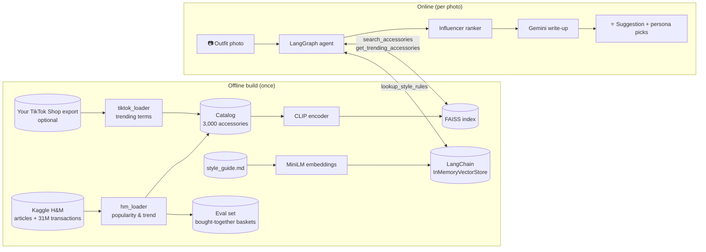
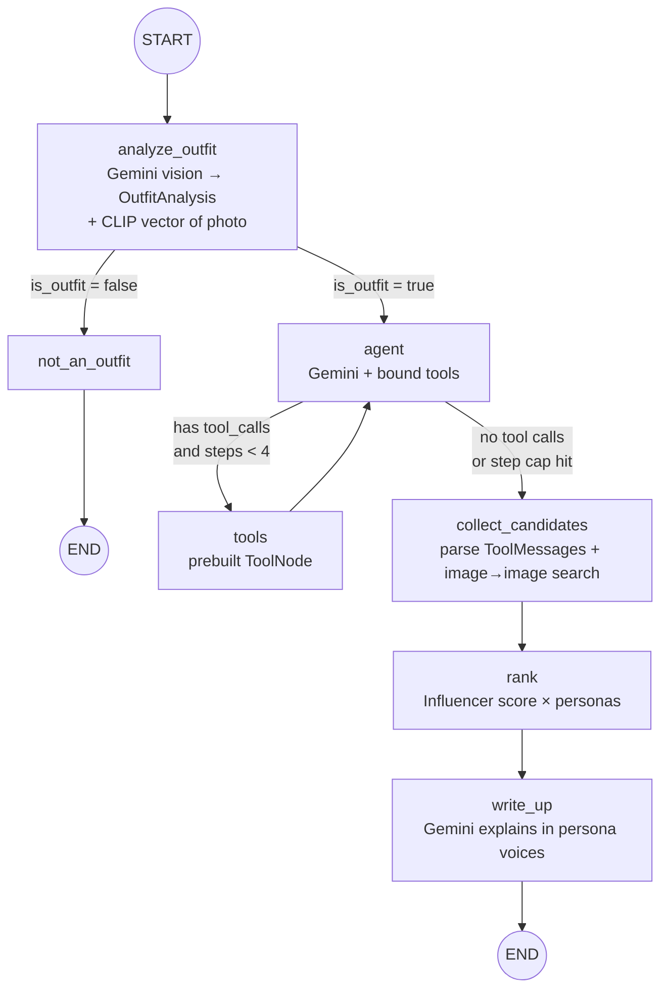

# Architecture

## 1. Context and goals

**Problem.** Given a photo of an outfit, recommend accessories that (a) look right with it, (b) are what people are actually buying now, and (c) work colour-wise, and explain why, like an influencer would.

**Goals**

| Goal | How it shows up in the design |
|---|---|
| Understand any outfit photo | Gemini vision with a typed output schema |
| Recommend only real products | Retrieval over a real catalog; LLM never invents items |
| Rank by style, trend and colour | Deterministic weighted "Influencer score" |
| Be explainable | Every score part is 0..1 and passed as evidence to the write-up |
| Beat keyword search measurably | Offline metrics on real baskets + blind LLM judge |
| Run free on Colab | Gemini free tier, CLIP on T4, 3k-item catalog, FAISS/NumPy |

**Non-goals:** virtual try-on, prices/checkout, user accounts, real-time scraping.

## 2. System overview



## 3. The LangGraph logic



### State (`agent/state.py`)

One `TypedDict` flows through every node. Nodes return only the keys they change.

| Key | Written by | Notes |
|---|---|---|
| `image_b64`, `mime_type`, `user_request`, `personas` | caller | inputs |
| `outfit` | analyze_outfit | `OutfitAnalysis` as dict |
| `outfit_embedding` | analyze_outfit | CLIP vector, reused by ranking |
| `messages` | analyze_outfit, agent, tools | `add_messages` reducer **appends** |
| `steps` | agent | loop counter for the safety cap |
| `candidates`, `style_notes` | collect_candidates | pooled from tool results |
| `ranked`, `persona_picks` | rank | final ordered items with evidence |
| `final_answer` | write_up / not_an_outfit | markdown |

### Nodes

1. **analyze_outfit** sends the photo as a LangChain multimodal message (`image_url` data URL) and calls `with_structured_output(OutfitAnalysis)`. If the provider rejects the schema it falls back to "reply in JSON" + Pydantic validation. It also embeds the photo with CLIP and seeds the conversation with a system prompt and the analysis.
2. **agent** is Gemini with `bind_tools([...])`. It plans: usually one `lookup_style_rules` then one `search_accessories` per suggested category, often in parallel tool calls.
3. **tools** is LangGraph's prebuilt `ToolNode`; it executes calls and appends `ToolMessage`s.
4. **route_after_agent** loops back while the model wants tools **and** `steps < max_agent_steps (4)`: a hard stop against runaway loops and API cost.
5. **collect_candidates** reads every `ToolMessage` (JSON), keeps each product's best match score, gathers retrieved rules, and **always** adds the 10 products most visually similar to the outfit photo (image→image). If the LLM skipped searching entirely, it runs category searches itself, so the graph never ends empty.
6. **rank** computes the Influencer score for the "editor" persona (top 5, max one per product type) and for each requested persona (top 2). It skips categories the person is already wearing.
7. **write_up** gives Gemini the evidence strings and asks for a short answer, with the ranker's order kept as is.

### Tools (`agent/tools.py`)

| Tool | Backed by | Returns |
|---|---|---|
| `search_accessories(query, category, colour, k)` | CLIP text vector → FAISS, category/colour filters | JSON list: id, name, type, colour, match, trend |
| `get_trending_accessories(category, k)` | catalog sorted by trend score | JSON list |
| `lookup_style_rules(question)` | LangChain vector store over `style_guide.md` | JSON list of rule sections |

Tools are built by a factory that closes over the loaded index, so there are no globals and tests can inject a tiny fake index.

## 4. Retrieval (RAG) design

**Catalog vectors.** `0.75 × CLIP(photo) + 0.25 × CLIP("name, colour type")`, L2-normalised; cosine = inner product in `faiss.IndexFlatIP` (exact search; 3k × 512 floats is ~6 MB). NumPy fallback if FAISS is missing.

**Why CLIP?** It is the simplest way to put images and text in one space: the agent searches with words, the ranker compares the outfit photo to product photos, and evaluation can query with a garment photo. No training is needed.

**Category filter.** Free-text categories from the LLM ("jewellery", "purse") map to H&M `product_type_name` substrings via a synonym table. If a filter would leave nothing, search falls back to the whole catalog.

**Style knowledge base.** Markdown split on `##` headings → `Document`s → `all-MiniLM-L6-v2` embeddings → `InMemoryVectorStore`. 16 short sections, so no chunking beyond headings is needed.

## 5. The Influencer score

```
influencer_score = ( w_style·style_fit + w_trend·trend_fit + w_color·color_fit + w_aff·persona_fit ) / Σw

style_fit   = min-max over the pool of  ½·(agent-query match) + ½·cos(outfit photo, product)
trend_fit   = 0.7·trend_score + 0.3·popularity_score        (H&M sales percentiles)
              blended 70/30 with tiktok_score when TikTok data is loaded
color_fit   = colour-wheel rules vs the outfit colours (neutral 0.8–0.85, metallic 0.85,
              monochrome 0.8, analogous 0.75, complementary 0.7, clash 0.35)
persona_fit = 0.5 + 0.2·(liked words, max 2) − 0.35·(avoided words, max 2), clipped to 0..1
```

| Persona | style | trend | colour | taste | Likes (examples) |
|---|---|---|---|---|---|
| Editor (default suggestion) | .45 | .30 | .25 | 0 | – |
| Mia the Minimalist | .40 | .10 | .30 | .20 | leather, thin, plain, gold, silver |
| Jay the Streetwear Creator | .30 | .40 | .10 | .20 | cap, chain, chunky, crossbody |
| Lena the Luxe Stylist | .40 | .15 | .25 | .20 | leather, gold, pearl, silk |
| Bea the Boho Influencer | .35 | .20 | .25 | .20 | fringe, beaded, woven, straw |

**Trend maths** (`hm_loader.compute_popularity`): dataset ends 2020-09-22. `recent` = last 4 weeks, `baseline` = the 12 weeks before. `lift = (recent/4 + 1) / (baseline/12 + 1)`, and `trend = percentile( log(lift) · log(1 + recent) )`. The second factor stops a jump from 0 to 2 sales from counting as a trend.

## 6. Key decisions (ADR summaries)

### ADR-1: Ranking is maths, not an LLM call
**Context:** we need a stable, explainable order that reflects sales data the LLM cannot see.
**Options:** (A) ask Gemini to rank the candidates; (B) a weighted score.
**Decision:** B. It is deterministic, free, instant, testable, and its parts become the explanation. The LLM does what it is good at: reading the photo, planning searches, writing.
**Consequence:** the weights are hand-set; learning them from basket data (e.g. logistic regression on bought-together pairs) is a natural next step.

### ADR-2: CLIP + FAISS instead of a hosted embedding API
**Options:** Gemini/OpenAI embeddings (text only, per-call cost), CLIP (image+text, local), fashion-tuned CLIP (FashionCLIP).
**Decision:** generic CLIP ViT-B/32 via sentence-transformers. It is free, runs on Colab, and covers both modalities. FashionCLIP is a one-line swap (`FA_CLIP_MODEL`) worth benchmarking.

### ADR-3: H&M as the data source (TikTok as a plug-in)
**Context:** the user wanted TikTok Shop / trendy-product data.
**Finding:** no free public TikTok Shop dataset exists; only paid third-party scrapers, whose data can't be re-shared.
**Decision:** H&M Kaggle data for real sales-based popularity and trends (non-commercial license fits a portfolio project), plus a loader that blends any TikTok export the user creates.
**Consequence:** "trending" means trending at the end of the dataset (Sept 2020), which the docs state clearly.

### ADR-4: Hand-written graph instead of `create_react_agent`
**Decision:** explicit nodes for vision, the tool loop, pooling, ranking and the write-up, so each stage is visible, testable and swappable, with a hard loop cap and an early-exit branch. A prebuilt ReAct agent would hide the ranking step inside free-form LLM text.

### ADR-5: Evaluation on bought-together baskets + blind LLM judge
**Context:** no labelled "this accessory suits this outfit" dataset at this scale.
**Decision:** same-day co-purchases are a real, if noisy, compatibility signal (offline, all queries, free). A blind randomised-order LLM judge measures perceived styling quality on a sample. The two together are more convincing than either alone.

## 7. Failure handling

| Failure | Handling |
|---|---|
| Photo is not clothing | conditional edge → `not_an_outfit` → END |
| Structured output refused | JSON fallback + Pydantic validation |
| LLM loops on tools | `max_agent_steps` cap routes to ranking |
| LLM never searches | `collect_candidates` searches each suggested category itself |
| Unknown category word | filter falls back to the full catalog |
| Free-tier rate limits | `max_retries=6` with backoff; judge loop pauses between calls |
| Missing H&M photo | product dropped during catalog build |
| Model renamed/retired | single setting `GEMINI_MODEL` |

## 8. Scaling notes

For 100k+ products, swap `IndexFlatIP` for `IndexHNSWFlat` or IVF-PQ, precompute trend scores in a daily batch job, cache outfit analyses by image hash, and serve the graph behind an API (LangGraph Platform or FastAPI). The graph and tools need no change; only the index class does.
