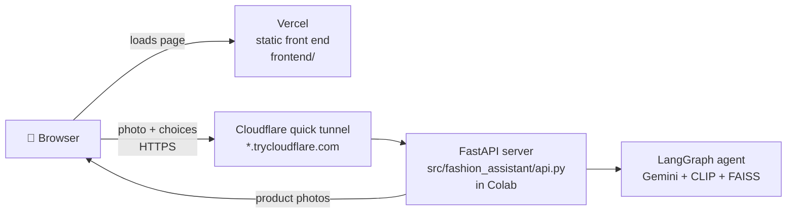

# Web App: Finishing Touch

The project ships with a real web front end, **Finishing Touch**, hosted on Vercel. The model behind it runs in Colab (or on your own machine).



## Why it's split this way

| Piece | Where | Why |
|---|---|---|
| Front end (HTML/CSS/JS) | Vercel | Free, permanent URL, auto-deploys from GitHub on every push |
| Model server | Colab (free T4) | CLIP + PyTorch is far over Vercel's ~250 MB function limit, and the H&M photos can't be published (non-commercial license) |
| Tunnel | Cloudflare quick tunnel | Gives the Colab server a public HTTPS address; no account needed |

## Use it

1. Run the notebook through section 4 (data, index, agent).
2. Run section 6, **Launch the web app**. It prints:
   ```
   ✓ model server running on port 8000
   ✓ public API: https://random-words.trycloudflare.com
   Open the app (Vercel):  https://finishing-touch.vercel.app/?api=https%3A%2F%2Frandom-words.trycloudflare.com
   ```
3. Open the Vercel link. The `?api=` part connects the site to your server, and the browser remembers it.

If you open the Vercel site without a server running, it asks for the server address. Paste the `trycloudflare.com` URL, or re-run the launch cell.

Running locally instead of Colab: `python serve.py --share --frontend https://finishing-touch.vercel.app`.

## What the page does

- **Upload** an outfit photo (drag and drop or file picker), add an optional occasion, and choose influencer personas.
- **Live progress**: the page shows each LangGraph node as it finishes, such as "Read the outfit", "Planned searches: gold drop earrings; small black clutch", "Ranked by style, trend and colour". This uses Server-Sent Events from `graph.stream()`, not a fake spinner.
- **Results**:
  - the Influencer Suggestion with its style / trend / colour score bars;
  - four alternatives, each with a hang tag showing its match score;
  - one pick per persona;
  - the stylist's notes written by Gemini;
  - a "How the agent got here" panel listing every tool call.
- **Selling fastest right now**: the trending strip, straight from the sales-based trend scores.

## API reference

| Method | Path | Body / query | Returns |
|---|---|---|---|
| GET | `/api/health` | – | `{status, model, catalog_size}` |
| GET | `/api/personas` | – | `[{key, name, voice}]` |
| GET | `/api/trending` | `category`, `k` (≤ 24) | items with `trend_score`, `trend_lift`, `image_url` |
| GET | `/api/items/{id}/image` | – | JPEG |
| POST | `/api/recommend` | multipart: `image`, `request`, `personas` (comma list) | full result JSON |
| POST | `/api/recommend/stream` | same | SSE: `step` events, then `result` (or `error`) |

Result JSON (shortened):
```json
{
  "outfit": {"garments": ["black slip dress"], "colors": ["black", "cream"], "style": "minimalist", "...": "..."},
  "ranked": [{"article_id": 706016001, "prod_name": "...", "style_fit": 0.92, "trend_fit": 0.71,
              "color_fit": 0.85, "influencer_score": 0.84, "image_url": "/api/items/706016001/image"}],
  "persona_picks": {"luxe": {"name": "Lena the Luxe Stylist", "picks": ["..."]}},
  "final_answer": "markdown",
  "trace": [{"tool": "search_accessories", "args": {"query": "gold drop earrings"}, "results": 12}],
  "agent_steps": 2, "candidates": 31, "seconds": 14.2
}
```

**Safety limits:** uploads are capped at 10 MB and checked to be real images. At most 2 runs execute at once, to stay inside Gemini's free-tier rate limit; extra requests get a clear "stylist is busy" message. CORS is open by default because the API is read-only and stores nothing. Set `FA_CORS_ORIGINS=https://your-app.vercel.app` to lock it down.

## Front-end design

- **Name:** *Finishing Touch*, since accessories are the finishing touch of an outfit.
- **Palette:** studio-backdrop lilac-grey `#E9E7EE`, aubergine ink `#24152B`, hang-tag pink `#F4B6CF`, brass `#A87B2D` for the metal grommets and score bars. There's a matching dark mode.
- **Type:** Bodoni Moda (the high-contrast fashion-magazine face) for headlines and scores, Hanken Grotesk for the interface.
- **Signature element:** every recommended product wears a pink paper hang tag with its Influencer score, like a price tag in a store.
- **Motion:** screens crossfade into each other (View Transitions API, with a CSS fallback). Agent steps glide in as they stream, and the waiting step shimmers. Results arrive in one cascade: the hero pick rises in, its score counts up, the score bars fill, then the alternatives and persona picks follow 70 ms apart while the tags swing into place. Photos fade in once loaded over a shimmer placeholder. On hover, photos zoom slightly and tags sway. Product rows can be dragged with the mouse and fade at the edge until you reach the end. With reduced motion on, everything appears instantly.
- **Fluid layout:** the type scale and spacing use `clamp()`, so the page scales continuously from phone to wide desktop instead of jumping at breakpoints.
- **Build:** plain HTML/CSS/JS with no build step, so Vercel serves `frontend/` as-is. It's responsive down to phone width, keyboard-accessible, and escapes all model text before rendering.

## Files

```
frontend/
├── index.html      page structure
├── styles.css      design tokens, layout, hang tags, dark mode
├── app.js          server connection, upload, SSE streaming, rendering
├── config.js       optional default server address
├── favicon.svg     hang-tag icon
└── vercel.json     static hosting headers
src/fashion_assistant/
├── api.py          FastAPI app (create_app)
└── launch.py       start server + Cloudflare tunnel, print links
serve.py            run the server outside Colab
tests/test_api.py   API tests with the scripted fake model
```
